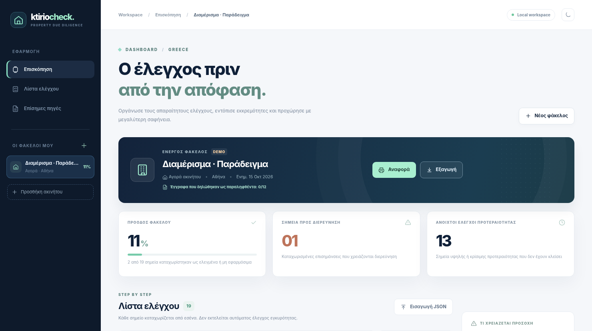

<div align="center">

# 🏠 KtirioCheck

**Ο έλεγχος πριν από την απόφαση.**

*Privacy-first checklist for Greek property purchases & rentals.*

   

</div>

## Τι είναι

Το **KtirioCheck** είναι ένα open-source εργαλείο *οργάνωσης προελέγχου* ακινήτου στην Ελλάδα. Βοηθά αγοραστές και υποψήφιους ενοικιαστές να ζητούν τα σωστά έγγραφα, να παρακολουθούν τις εκκρεμότητές τους και να προετοιμάζονται για ουσιαστική συζήτηση με δικηγόρο, μηχανικό και συμβολαιογράφο.

> **Όχι αυτοματοποιημένος έλεγχος ή νομική γνωμάτευση.** Η εφαρμογή δεν συνδέεται με Κτηματολόγιο, ΑΑΔΕ, ΤΕΕ ή άλλους δημόσιους φορείς, δεν αναγνωρίζει γνησιότητα εγγράφων και δεν πιστοποιεί αν ένα ακίνητο είναι «ασφαλές» ή νόμιμο.

## Preview



## Βασικές λειτουργίες (v0.1.0)

- **Αγορά ή ενοικίαση:** διαφορετική λίστα ελέγχων ανά συναλλαγή.
- **Πολλαπλά ακίνητα:** ξεχωριστός φάκελος για κάθε πιθανή επιλογή.
- **5 κατηγορίες:** νομικά, πολεοδομικά, φορολογικά, τεχνικά, όροι/κόστος.
- **5 καταστάσεις:** δεν ξεκίνησε, ζητήθηκαν στοιχεία, ελέγχθηκε, χρειάζεται διερεύνηση, δεν εφαρμόζεται.
- **Προτεραιοποίηση:** ανοιχτά κρίσιμα σημεία και ζητήματα προς διερεύνηση.
- **Παρακολούθηση συλλογής εγγράφων:** ξεχωριστή ένδειξη «Παρέλαβα το σχετικό έγγραφο» για κάθε σχετικό σημείο — καταγράφεται μόνο η παραλαβή, όχι το ίδιο το έγγραφο.
- **Σημειώσεις, αναζήτηση και φίλτρα.**
- **Αναφορά εκτύπωσης/PDF** μέσω της λειτουργίας εκτύπωσης του browser.
- **Εξαγωγή/εισαγωγή JSON** για τοπικό backup ή μεταφορά φακέλου.
- **Light/Dark mode**, responsive layout.
- **Χωρίς cookies παρακολούθησης, analytics ή backend.** Τα δεδομένα αποθηκεύονται στο `localStorage` του browser.

Το πρώτο άνοιγμα εμφανίζει ένα **DEMO** με *φανταστικές καταχωρίσεις*. Δημιούργησε «Νέο φάκελο» για πραγματική χρήση.

## Γρήγορη εκκίνηση σε Windows

**Απαιτείται Node.js 20 ή νεότερο.** Δεν απαιτείται `npm install` ή backend/database.

```powershell
cd "$env:USERPROFILE\Desktop\ktirio-check"
npm run dev
```

Άνοιξε **http://localhost:5500** στον browser. Για να σταματήσεις τον server, `Ctrl+C`.

> Μην ανοίγεις απευθείας το `index.html` με διπλό κλικ (`file://`): τα JavaScript modules χρειάζονται HTTP origin. Μπορείς εναλλακτικά να εκτελέσεις `python -m http.server 5500`.

### Έλεγχοι / tests

```powershell
npm run check
```

Χρησιμοποιούνται **Node.js built-in tests**, χωρίς εξωτερικές βιβλιοθήκες.

## Ανέβασμα στο GitHub

1. Δημιούργησε ένα **κενό public repository** με όνομα `ktirio-check` (χωρίς auto-generated README/license).
2. Άνοιξε PowerShell **μέσα στον φάκελο** του project και εκτέλεσε:

```powershell
git init
git add .
git commit -m "feat: launch KtirioCheck MVP"
git branch -M main
git remote add origin https://github.com/YOUR_USERNAME/ktirio-check.git
git push -u origin main
```

3. Στο GitHub πήγαινε **Settings → Pages → Build and deployment → Source: GitHub Actions**.
4. Το workflow `.github/workflows/pages.yml` θα κάνει deploy μετά από επιτυχημένα tests (εφόσον το GitHub Pages είναι ενεργό).
5. Το URL της εφαρμογής θα είναι `https://YOUR_USERNAME.github.io/ktirio-check/`.

Τα workflows περιλαμβάνουν **CI** για κάθε push/PR στο `main` και ξεχωριστό **GitHub Pages deployment**.

## Φάκελοι

```text
ktirio-check/
├── index.html                  # App shell / dialogs
├── styles.css                  # Responsive UI + themes + print CSS
├── favicon.svg                 # App icon
├── server.mjs                  # Local dev server (no dependencies)
├── src/
│   ├── app.mjs                 # Browser UI and interactions
│   ├── catalog.mjs             # Data-driven Greek due-diligence checklist
│   └── engine.mjs              # Validation, filtering, reporting model
├── tests/
│   └── engine.test.mjs         # Built-in Node tests
├── docs/
│   ├── preview.png             # Dashboard screenshot
│   └── sources.md              # Official sources + scope notes
├── .github/workflows/
│   ├── ci.yml                  # Automated checks
│   └── pages.yml               # GitHub Pages deploy
├── LICENSE
└── README.md
```

## Ιδιωτικότητα και ασφάλεια

- Δεν υπάρχει login, εξωτερικό API, βάση δεδομένων, αποθήκευση εγγράφων, telemetry ή server-side επεξεργασία.
- Η εφαρμογή αποθηκεύει **τίτλους φακέλων, περιοχές, σημειώσεις και καταστάσεις** τοπικά στον browser. Απόφυγε ονόματα τρίτων, ΑΦΜ, οικονομικά αναγνωριστικά, διευθύνσεις ευάλωτων προσώπων και κωδικούς.
- Αν διαγράψεις τα δεδομένα browser, μπορεί να χαθούν οι φάκελοι. Χρησιμοποίησε **Εξαγωγή JSON** για backup. Το JSON μπορεί να περιέχει προσωπικές σημειώσεις: φύλαξέ το με ασφάλεια.
- Η εφαρμογή δεν παρέχει κρυπτογράφηση των δεδομένων στο `localStorage`. Σε κοινόχρηστους υπολογιστές **μην την χρησιμοποιείς με πραγματικά προσωπικά δεδομένα**.
- Πριν από εμπορικό SaaS με upload εγγράφων, χρειάζονται αυθεντικοποίηση, κατάλληλη ασφαλής αποθήκευση, πολιτικές διατήρησης/διαγραφής, GDPR assessment, έλεγχος πρόσβασης, logging και συμβατικοί ρόλοι συνεργατών.

## Νομικός / τεχνικός περιορισμός

Τα checklists αποτελούν **ενδεικτικό εργαλείο οργάνωσης**. Οι απαιτήσεις διαφέρουν ανάλογα με είδος, ηλικία, θέση, χρήση, καθεστώς και ιδιοκτησιακή κατάσταση του ακινήτου και μπορούν να αλλάξουν. Η ένδειξη «Ελέγχθηκε» είναι **αυτοδήλωση του χρήστη** και δεν συνιστά ανεξάρτητη επικύρωση. Πριν από προκαταβολή, υπογραφή ή άλλη δέσμευση, ζήτησε ειδική αξιολόγηση από επαγγελματίες.

Οι βασικές πληροφοριακές πηγές παρατίθενται στο [`docs/sources.md`](docs/sources.md). Τελευταία θεματική ανασκόπηση **15 Οκτωβρίου 2026**.

## Roadmap

- [ ] Σύνδεση επαληθευμένων συνεργατών (δικηγόρου, μηχανικού, συμβολαιογράφου) με role-based permissions.
- [ ] Ασφαλής διαχείριση εγγράφων με συγκατάθεση και κρυπτογράφηση.
- [ ] Πιο εξειδικευμένα checklists (μονοκατοικία, οικόπεδο, επαγγελματική μίσθωση).
- [ ] Reviewer workflow με ημερομηνία, υπογραφή και audit trail.
- [ ] Διαθεσιμότητα ελληνικών / αγγλικών.
- [ ] Αυτοματοποιημένη ενημέρωση περιεχομένου μετά από επαγγελματικό review.

## Συνεισφορά

Pull requests για βελτιώσεις UX, tests, προσβασιμότητας ή επαληθευμένα νομικά/τεχνικά references είναι ευπρόσδεκτα. **Μην ανεβάζεις πραγματικά συμβόλαια, ΚΑΕΚ, ΑΦΜ ή άλλα προσωπικά δεδομένα σε δημόσια issues.**

## License

MIT — δες το [`LICENSE`](LICENSE).
